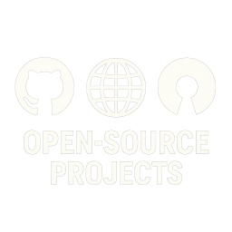

<a id="readme-top"></a>

[![Contributors][contributors-shield]][contributors-url]
[![Forks][forks-shield]][forks-url]
[![Stargazers][stars-shield]][stars-url]
[![Issues][issues-shield]][issues-url]
[![License][license-shield]][license-url]

<div align="center">
  <a href="https://github.com/LoveDoLove/open-source-projects">
    
  </a>

  <h1 align="center">Open Source Projects</h1>

  <p align="center">
    <strong>Dual-mode open source repository showcase deployed on Cloudflare Workers edge.</strong>
    <br />
    Serves responsive UI to human browsers and pre-tokenized, structured Markdown to AI coding agents.
    <br />
    <br />
    <a href="https://open-source-projects.lovedolove.workers.dev"><strong>View Live Demo »</strong></a>
    <br />
    <br />
    <a href="README.md">English</a> &middot;
    <a href="README.zh-CN.md">简体中文</a> &middot;
    <a href="docs/whitepaper.md">Whitepaper</a> &middot;
    <a href="docs/architecture.md">Architecture</a> &middot;
    <a href="https://github.com/LoveDoLove/open-source-projects/issues">Report Issue</a>
  </p>
</div>

<details>
  <summary><strong>Table of Contents</strong></summary>
  <ol>
    <li><a href="#overview">Overview</a></li>
    <li><a href="#key-features">Key Features</a></li>
    <li><a href="#dual-mode-content-negotiation">Dual-Mode Content Negotiation</a></li>
    <li><a href="#documentation-index">Documentation Index</a></li>
    <li><a href="#quick-start">Quick Start</a></li>
    <li><a href="#adding-a-project">Adding a Project</a></li>
    <li><a href="#automated-ci-pipeline">Automated CI Pipeline</a></li>
    <li><a href="#roadmap">Roadmap</a></li>
    <li><a href="#contributing">Contributing</a></li>
    <li><a href="#license">License</a></li>
  </ol>
</details>

---

## Overview

**Open Source Projects** is a curated repository showcase engineered for high performance, high discoverability, and zero maintenance overhead. Built natively on **Cloudflare Workers** with Static Assets, it eliminates heavy single-page application frameworks in favor of clean semantic HTML/CSS/JavaScript.

Beyond human readability, it natively supports the emerging AI agent ecosystem. By evaluating HTTP `Accept` headers at edge routing time, the service streams dense, structured Markdown to LLMs and AI coding assistants while serving a fast, responsive card interface to web browsers.

<div align="center">
  
</div>

## Key Features

- **Dual-Mode Edge Delivery:** Edge worker negotiates `Accept: text/markdown` to deliver structured Markdown for AI agents and static HTML/CSS/JS for human visitors.
- **Agent Token Efficiency:** Strips DOM boilerplate, styles, and scripts for agents, cutting token consumption by ~85% with an exact `x-markdown-tokens` header.
- **Zero-Build Architecture:** Pure HTML5, modern CSS custom properties, and vanilla ES6+. Runs directly in browsers and edge assets without complex bundler pipelines.
- **Automated Metadata Pipeline:** Daily GitHub Actions workflow syncs stars, forks, issues, and topics using the GitHub REST API.
- **Atomic Bot Commit Deduplication:** Custom Git workflow folds daily metadata updates into a single clean commit, preventing commit history pollution.
- **Global Edge Speed:** Sub-50ms TTFB across hundreds of Cloudflare edge locations worldwide.

## Dual-Mode Content Negotiation

### Human visitor (Web browser)
Browsers request HTML by default. Cloudflare Workers serves static assets directly from `public/`:
```bash
curl -I https://open-source-projects.lovedolove.workers.dev
# Returns: content-type: text/html; charset=utf-8
```

### AI Coding Agent (curl / LLM tool)
AI agents request Markdown via HTTP headers. The edge worker intercepts the request and synthesizes clean Markdown on the fly:
```bash
curl -H "Accept: text/markdown" https://open-source-projects.lovedolove.workers.dev
```

Response preview:
```markdown
# Open Source Projects

A curated collection of open-source projects by LoveDoLove.

## [open-source-projects](https://github.com/LoveDoLove/open-source-projects)
- **Description:** A curated collection of open-source projects showcasing tools...
- **Stars:** 0 | **Forks:** 0 | **Updated:** 2026-09-01
- **Topics:** cloudflare-workers, markdown-for-agents, open-source
```

## Documentation Index

Comprehensive technical documentation is maintained in the [`docs/`](docs/) directory:

| Document | Description |
| :--- | :--- |
| **[System Architecture](docs/architecture.md)** | Cloudflare Workers edge runtime, asset routing, and content negotiation. |
| **[Metadata Pipeline](docs/metadata-pipeline.md)** | Metadata schema, GitHub API synchronization, and atomic commit deduplication. |
| **[Deployment & Ops](docs/deployment.md)** | Cloudflare Git integration, Wrangler CLI configuration, and observability. |
| **[Contributing Guide](docs/contributing.md)** | Local environment setup, adding repositories, and pull request checklist. |
| **[Technical Whitepaper (EN)](docs/whitepaper.md)** | System vision, architectural principles, token economics, and future roadmap. |
| **[白皮书 (简体中文)](docs/whitepaper.zh-CN.md)** | 系统愿景、设计哲学、Token 经济学与未来演进路线图。 |
| **[AI Agent Guide](AGENTS.md)** | Operational guide and invariants for AI coding assistants. |

## Quick Start

### Prerequisites
- [Node.js](https://nodejs.org/) (v18.0.0 or later)
- [pnpm](https://pnpm.io/) (v10.0.0 or later)
- [Cloudflare Wrangler CLI](https://developers.cloudflare.com/workers/wrangler/) (`npm install -g wrangler`)

### Installation & Local Development

1. **Clone repository:**
   ```bash
   git clone https://github.com/LoveDoLove/open-source-projects.git
   cd open-source-projects
   ```

2. **Install dependencies:**
   ```bash
   pnpm install
   ```

3. **Start local development server:**
   ```bash
   pnpm dev
   ```
   Navigate to `http://localhost:8787` in your browser.

4. **Test agent Markdown negotiation:**
   ```bash
   curl -H "Accept: text/markdown" http://localhost:8787
   ```

5. **Deploy to Cloudflare Workers:**
   ```bash
   pnpm deploy
   ```

## Adding a Project

The repository list is configured in `data/projects.json`. Never hand-edit `public/data/projects.json`.

1. Edit `data/projects.json` and add your repository entry:
   ```json
   {
     "name": "your-repo-name",
     "user": "LoveDoLove",
     "repo": "your-repo-name",
     "url": "https://github.com/LoveDoLove/your-repo-name"
   }
   ```

2. Run the metadata fetch script:
   ```bash
   node scripts/fetchRepoMetadata.js
   ```

3. Verify changes locally with `pnpm dev` and commit your edits.

## Automated CI Pipeline

The project features a fully automated metadata synchronization workflow in [`.github/workflows/fetch-repo-metadata.yml`](.github/workflows/fetch-repo-metadata.yml):
- **Schedule:** Runs daily at midnight UTC (`cron: '0 0 * * *'`) and on manual dispatch.
- **Atomic Commit Folding:** Detects prior automated commits by `github-actions[bot]` and rewrites them using `--force-with-lease`, keeping Git history concise.
- **Zero Build Friction:** Pushes to `main` immediately trigger Cloudflare Workers deployment.

## Roadmap

- [x] Cloudflare Workers Edge Native Migration
- [x] Dual-mode Markdown for Agents content negotiation
- [x] Automated GitHub Actions metadata synchronization
- [x] Commit-folding history management
- [ ] Multi-provider synchronization (GitLab, Gitee, Bitbucket)
- [ ] Agentic semantic search endpoint (`/api/search?q=...`)
- [ ] Dynamic topic filtering and category taxonomy
- [ ] Agent-to-Agent interactive queries via WebMCP tools

## Contributing

Contributions are welcomed! Please read our **[Contributing Guide](docs/contributing.md)** for conventions and guidelines before opening a pull request.

1. Fork the Project
2. Create your Feature Branch (`git checkout -b feature/AmazingFeature`)
3. Commit your Changes (`git commit -m 'feat: add AmazingFeature'`)
4. Push to the Branch (`git push origin feature/AmazingFeature`)
5. Open a Pull Request

## License

Distributed under the MIT License. See [`LICENSE`](LICENSE) for details.

---

<div align="center">
  <sub>Crafted with care by <a href="https://github.com/LoveDoLove">LoveDoLove</a> &middot; Powered by Cloudflare Workers & GitHub Actions</sub>
</div>

[contributors-shield]: https://img.shields.io/github/contributors/LoveDoLove/open-source-projects.svg?style=for-the-badge
[contributors-url]: https://github.com/LoveDoLove/open-source-projects/graphs/contributors
[forks-shield]: https://img.shields.io/github/forks/LoveDoLove/open-source-projects.svg?style=for-the-badge
[forks-url]: https://github.com/LoveDoLove/open-source-projects/network/members
[stars-shield]: https://img.shields.io/github/stars/LoveDoLove/open-source-projects.svg?style=for-the-badge
[stars-url]: https://github.com/LoveDoLove/open-source-projects/stargazers
[issues-shield]: https://img.shields.io/github/issues/LoveDoLove/open-source-projects.svg?style=for-the-badge
[issues-url]: https://github.com/LoveDoLove/open-source-projects/issues
[license-shield]: https://img.shields.io/github/license/LoveDoLove/open-source-projects.svg?style=for-the-badge
[license-url]: https://github.com/LoveDoLove/open-source-projects/blob/main/LICENSE
