[//]: # (README.zh-CN.md)

<a id="readme-top"></a>

[![Contributors][contributors-shield]][contributors-url]
[![Forks][forks-shield]][forks-url]
[![Stargazers][stars-shield]][stars-url]
[![Issues][issues-shield]][issues-url]
[![License][license-shield]][license-url]

<div align="center">
  <a href="https://github.com/LoveDoLove/open-source-projects">
    
  </a>

  <h1 align="center">Open Source Projects</h1>

  <p align="center">
    <strong>基于 Cloudflare Workers 边缘计算的开源项目展示平台。</strong>
    <br />
    同时面向人类浏览器（响应式 UI）与 AI 编码代理（预分词结构化 Markdown）。
    <br />
    <br />
    <a href="https://open-source-projects.lovedolove.workers.dev"><strong>访问在线演示 »</strong></a>
    <br />
    <br />
    <a href="README.md">English</a> &middot;
    <a href="README.zh-CN.md">简体中文</a> &middot;
    <a href="docs/whitepaper.md">Whitepaper</a> &middot;
    <a href="docs/architecture.md">Architecture</a> &middot;
    <a href="https://github.com/LoveDoLove/open-source-projects/issues">报告问题</a>
  </p>
</div>

<details>
  <summary><strong>目录</strong></summary>
  <ol>
    <li><a href="#overview">项目概述</a></li>
    <li><a href="#key-features">核心特性</a></li>
    <li><a href="#dual-mode-content-negotiation">双模式内容协商</a></li>
    <li><a href="#documentation-index">文档索引</a></li>
    <li><a href="#quick-start">快速开始</a></li>
    <li><a href="#adding-a-project">添加项目</a></li>
    <li><a href="#automated-ci-pipeline">自动化 CI 流水线</a></li>
    <li><a href="#roadmap">路线图</a></li>
    <li><a href="#contributing">参与贡献</a></li>
    <li><a href="#license">开源许可</a></li>
  </ol>
</details>

---

## 项目概述

**Open Source Projects** 是一个精心打造的开源项目展示平台，旨在实现高性能、高可发现性与零运维成本。项目完全基于 **Cloudflare Workers** 和静态资源（Static Assets）构建，摒弃了臃肿的前端框架，转而使用精简的 HTML/CSS/JavaScript 原生实现。

除了人类可读，本项目还深度适配了新兴的 AI 代理生态。通过边缘路由时的 HTTP `Accept` 头评估，该服务能向 LLM 和 AI 编码助手输送密集、结构化的 Markdown 内容，同时向人类浏览器用户提供快速、响应式的卡片交互界面。

## 核心特性

- **双模式边缘交付：** 边缘 worker 根据 `Accept: text/markdown` 请求头，智能切换交付结构化 Markdown（给 AI）或静态 HTML/CSS/JS（给用户）。
- **AI Token 效率：** 为 AI 代理剔除了 DOM 样板、样式表和脚本，通过 `x-markdown-tokens` 精确头部标识，Token 消耗降低约 85%。
- **零构建架构：** 纯 HTML5，原生 CSS 自定义属性与 vanilla ES6+。无需复杂构建流水线即可在边缘运行。
- **自动化元数据管线：** 每日 GitHub Actions 工作流同步 Stars、Forks、Issues 和 Topics 等数据。
- **原子化 Git 提交合并：** 自定义 Git 工作流将每日的元数据自动更新折叠为单条简洁提交，保持 Git 历史整洁。
- **全球边缘加速：** 在全球数百个 Cloudflare 边缘节点运行，TTFB 低至 50ms。

## 双模式内容协商

### 人类访客 (Web 浏览器)
浏览器默认请求 HTML，Cloudflare Workers 从 `public/` 直接交付静态资源：
```bash
curl -I https://open-source-projects.lovedolove.workers.dev
# 返回: content-type: text/html; charset=utf-8
```

### AI 编码代理 (curl / LLM 工具)
AI 代理通过 HTTP 头请求 Markdown。边缘 worker 拦截该请求并实时合成为精简的 Markdown：
```bash
curl -H "Accept: text/markdown" https://open-source-projects.lovedolove.workers.dev
```

## 文档索引

详尽的技术规格维护在 [`docs/`](docs/) 目录中：

| 文档 | 描述 |
| :--- | :--- |
| **[系统架构](docs/architecture.md)** | Cloudflare Workers 边缘运行时、资产路由与内容协商机制。 |
| **[元数据管线](docs/metadata-pipeline.md)** | 数据模式、GitHub API 同步与原子提交折叠机制。 |
| **[部署与运维](docs/deployment.md)** | Cloudflare Git 集成、Wrangler CLI 配置与可观测性。 |
| **[贡献指南](docs/contributing.md)** | 本地环境搭建、项目添加与 PR 提交检查清单。 |
| **[技术白皮书 (EN)](docs/whitepaper.md)** | 系统愿景、架构原则、Token 经济学与未来路线图。 |
| **[白皮书 (简体中文)](docs/whitepaper.zh-CN.md)** | 系统愿景、设计哲学、Token 经济学与未来演进路线图。 |
| **[AI Agent 指引](AGENTS.md)** | 面向 AI 编码助手的操作指南与不变性规则。 |

## 快速开始

### 前置要求
- [Node.js](https://nodejs.org/) (v18.0.0 或更高)
- [pnpm](https://pnpm.io/) (v10.0.0 或更高)
- [Cloudflare Wrangler CLI](https://developers.cloudflare.com/workers/wrangler/) (`npm install -g wrangler`)

### 安装与本地开发

1. **克隆仓库：**
   ```bash
   git clone https://github.com/LoveDoLove/open-source-projects.git
   cd open-source-projects
   ```

2. **安装依赖：**
   ```bash
   pnpm install
   ```

3. **启动本地开发服务器：**
   ```bash
   pnpm dev
   ```
   浏览器访问 `http://localhost:8787`。

4. **测试 AI Markdown 内容协商：**
   ```bash
   curl -H "Accept: text/markdown" http://localhost:8787
   ```

5. **部署至 Cloudflare Workers：**
   ```bash
   pnpm deploy
   ```

## 添加项目

仓库列表配置在 `data/projects.json`。**切勿手动编辑 `public/data/projects.json`。**

1. 在 `data/projects.json` 中添加您的项目：
   ```json
   {
     "name": "your-repo-name",
     "user": "LoveDoLove",
     "repo": "your-repo-name",
     "url": "https://github.com/LoveDoLove/your-repo-name"
   }
   ```

2. 运行元数据同步脚本：
   ```bash
   node scripts/fetchRepoMetadata.js
   ```

3. 通过 `pnpm dev` 在本地验证，确认无误后提交更改。

## 自动化 CI 流水线

项目具备全自动化的元数据同步工作流，位于 [`.github/workflows/fetch-repo-metadata.yml`](.github/workflows/fetch-repo-metadata.yml)：
- **定时触发：** 每日 UTC 午夜 (`cron: '0 0 * * *'`) 或手动触发。
- **原子提交合并：** 自动检测并重写 `github-actions[bot]` 生成的提交，保持 Git 历史精简。
- **零摩擦部署：** `main` 分支的提交会自动触发 Cloudflare Workers 的更新。

## 路线图

- [x] Cloudflare Workers 边缘原生化迁移
- [x] AI 友好的双模式 Markdown 内容协商
- [x] 自动化 GitHub Actions 元数据同步
- [x] 提交折叠式历史管理
- [ ] 多平台同步 (GitLab, Gitee, Bitbucket)
- [ ] AI 语义搜索 API (`/api/search?q=...`)
- [ ] 动态主题过滤与分类标签系统
- [ ] 通过 WebMCP 工具实现代理间交互查询

## 贡献

欢迎提交贡献！在发起 PR 前，请阅读我们的 **[贡献指南](docs/contributing.md)**。

1. Fork 本项目
2. 创建特性分支 (`git checkout -b feat/AmazingFeature`)
3. 提交修改 (`git commit -m 'feat: add AmazingFeature'`)
4. 推送分支 (`git push origin feat/AmazingFeature`)
5. 发起 Pull Request

## 开源许可

本项目采用 MIT 许可。详见 [`LICENSE`](LICENSE)。

---

<div align="center">
  <sub>由 <a href="https://github.com/LoveDoLove">LoveDoLove</a> 精心制作 &middot; 由 Cloudflare Workers 与 GitHub Actions 强力驱动</sub>
</div>
